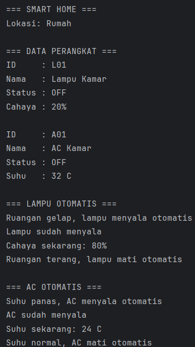
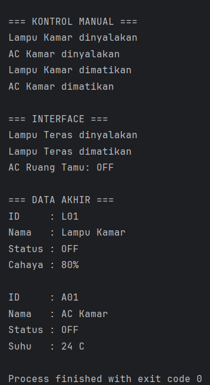

# Smart Home

Program simulasi Smart Home sederhana menggunakan bahasa pemrograman Java dengan menerapkan konsep Object Oriented Programming (OOP).

## Identitas
- Nama: Kautsar Rifqi Aditya
- NIM: H1D025084
- Tema: IoT (Digit terakhir NIM: 4)

## Deskripsi Program
Program ini mensimulasikan dua perangkat Smart Home, yaitu lampu dan AC. Kedua perangkat dapat dinyalakan dan dimatikan secara manual maupun otomatis.

Lampu akan menyala otomatis jika tingkat cahaya kurang dari 40%, sedangkan AC akan menyala otomatis jika suhu ruangan lebih dari 28°C.

Nilai cahaya dan suhu ditentukan langsung di dalam kode sebagai simulasi sensor.

## Konsep OOP
Program menerapkan:
1. State dan Behavior
2. Immutability
3. Encapsulation dan Constructor Overloading
4. Inheritance
5. Super Chaining
6. Method Overriding
7. Abstract Class
8. Percabangan dan Perubahan State
9. Polymorphism melalui Interface
10. Multiple Interface

## Struktur Program
- Alat.java - Abstract superclass
- Lampu.java - Class lampu
- AC.java - Class AC
- Kontrol.java - Interface kontrol perangkat
- Pantau.java - Interface monitoring perangkat
- Main.java - Class utama untuk pengujian

## Cara Menjalankan

### Melalui IntelliJ IDEA
1. Buka project Smart Home di IntelliJ IDEA.
2. Buka file Main.java.
3. Klik Run pada method main().
4. Hasil program akan muncul di terminal Run.

### Melalui Terminal
Masuk ke folder src, kemudian compile:

```bash
javac *.java
```

Jalankan program:

```bash
java Main
```

## Screenshot Output



